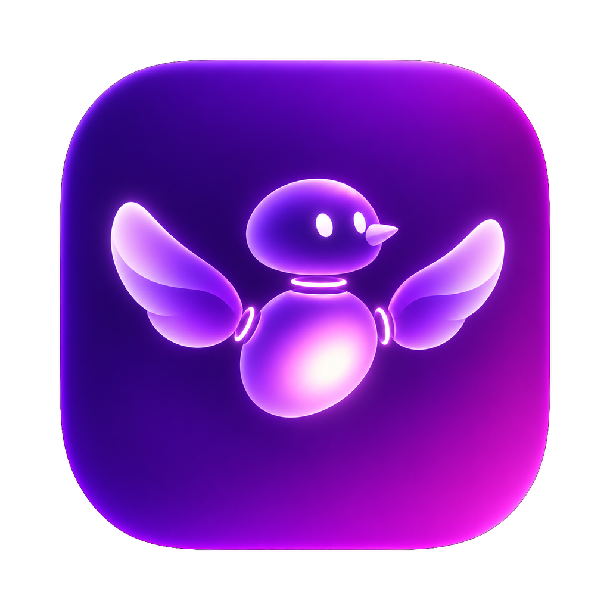

<p align="center">
  
</p>

<h1 align="center">GlowBar</h1>

<p align="center">
  Light along the top of your Mac's screen that reacts to your music, brightness, volume, shortcuts and more.<br>
  Free and open source · by <b>tpupsniper</b>
</p>

<p align="center">
  <a href="https://github.com/tpupsniper/GlowBar/releases/latest"><b>⬇️ Download</b></a> ·
  <a href="https://buymeacoffee.com/tpupsniper"><b>☕ Buy me a coffee</b></a>
</p>

---

## What it does

- **Glows around the top of your screen and the notch.** Choose from five shapes, and set a different one for each display (or turn it off).
- **Brightness & volume** light up as a bar that grows out from the notch. The volume keys move in smooth, fine steps.
- **Now playing in the notch.** While Spotify or Apple Music plays, the notch widens with album art on the left and a sound wave on the right. A wave of light rolls across the top, and a sweep runs on every new track. You can adjust the width and thickness.
- **A color for every shortcut:** ⌘A, ⌘C, ⌘X, ⌘V, ⌘Z, ⌘S, ⌘N/⌘T, ⌘W, ⌘Q, Caps Lock and more, each with its own color and movement.
- **13 keyboard sounds,** from mechanical switches (Blue, Brown, Red, Thocky, Topre, Buckling Spring…) to Ink, Typewriter and Bubble. Off by default.
- **Keystroke lights** that bounce around the edge of the screen. Off by default.
- **Everyday glows:** screenshot, copy, mic in use, charger, low battery, AirDrop received, meeting soon, focus timer and AI agent waiting.
- **A bird in the menu bar** that dances while music plays. (Try turning that off.)
- Plays nicely with other notch apps, and hides its notch player when your mouse is over it.

Every glow has its own on/off switch, color and Test button.

## Install

Requires a Mac with **Apple Silicon (M1 or newer)** and **macOS 14 Sonoma or later**.

1. Download the latest **GlowBar-app-….zip** from [Releases](https://github.com/tpupsniper/GlowBar/releases/latest).
2. Unzip it and drag **GlowBar** into your **Applications** folder.
3. Open it. GlowBar isn't notarized by Apple (I'm a solo dev and didn't pay for the $99/year program), so macOS will block it the first time:
   - Go to **System Settings → Privacy & Security**, scroll down, and click **Open Anyway** next to GlowBar.
   - Or paste this in Terminal: `xattr -dr com.apple.quarantine /Applications/GlowBar.app && open /Applications/GlowBar.app`

   If you'd rather not trust a download, the code is all here. Build it yourself (see below).

4. *(Optional)* For key sounds, shortcut colors and fine volume steps, allow GlowBar under **System Settings → Privacy & Security → Accessibility**.

## Privacy

- No accounts, no ads, no analytics, no tracking.
- **Nothing you type is recorded, stored or sent anywhere.** Accessibility access is only used to play key sounds, light up shortcuts and handle the volume keys, entirely on your Mac.
- The only thing GlowBar downloads is the album art for the song that's playing, straight from Spotify.
- Calendar, Reminders and Downloads access are only requested if you turn on those glows.

## Build it yourself

```bash
git clone https://github.com/tpupsniper/GlowBar.git
cd GlowBar
bash build.sh        # builds and installs GlowBar into /Applications
```

You'll need Apple's free command line tools (`xcode-select --install`).

## Support

GlowBar is free. If it brightens your day, you can [buy me a coffee ☕](https://buymeacoffee.com/tpupsniper).

## License

[MIT](LICENSE) © tpupsniper
